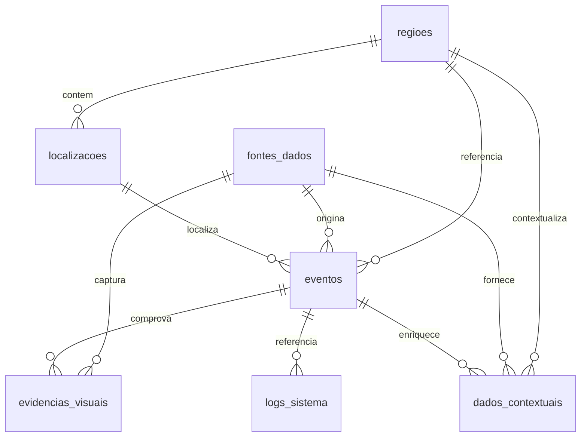

# Banco de dados

[← voltar ao README](../README.md#documentação)

## 6. Banco de dados

Tudo o que roda hoje usa SQLite: o ambiente local, os testes e o Cloud Run (lá o banco
fica dentro do container e começa vazio a cada nova versão, ver
[§21](deploy.md#21-deploy-no-google-cloud-run)). O `database/schema.sql` e o
`database/migrations/` descrevem o mesmo schema em MySQL 8, que continua funcionando pelo
`DATABASE_URL`. Com SQLite, o `main.py` cria as tabelas quando o sistema inicia e o
`database.py` liga `PRAGMA journal_mode=WAL` e `busy_timeout=30000`. Isso é preciso porque
as threads de monitoramento gravam no banco junto com as requisições HTTP, e sem isso o
SQLite dá o erro `database is locked`.

### Diagrama entidade-relacionamento

### Tabelas

| Tabela | Model | Função |
|---|---|---|
| `regioes` | `Regiao` | Divisão geográfica da cidade (nome, código e um polígono GeoJSON opcional). |
| `localizacoes` | `Localizacao` | Coordenadas e endereço. A detecção cria uma localização para cada evento, e a limpeza apaga as que ficam sem uso. |
| `fontes_dados` | `FonteDados` | Origem do evento. Na prática, uma fonte `yolo` por câmera. É o tipo `yolo` que permite devolver um evento `ativo` para análise automaticamente. |
| `eventos` | `Evento` | O evento urbano. Campos principais: `tipo`, `severidade`, `status`, `confianca` (nota do Data Fusion) e `detectado_em`. |
| `evidencias_visuais` | `EvidenciaVisual` | Imagem, com `modelo_ia`, `classe_detectada`, `confianca`, `bbox` e o SHA-256 da original em `metadados`. |
| `dados_contextuais` | `DadoContextual` | Pares de chave e valor por evento. A categoria `contexto` alimenta a dimensão de contexto do Data Fusion. |
| `logs_sistema` | `LogSistema` | Diagnóstico. O Data Fusion grava aqui (com as notas) só quando muda o status de um evento. |

### Enums do domínio

- Severidade: `baixa` · `media` · `alta` · `critica`
- Status do evento: `em_analise` · `ativo`
- Tipo de evidência: `imagem` · `video` · `frame` · `thumbnail`
- Nível de log: `DEBUG` · `INFO` · `WARN` · `ERROR` · `CRITICAL`

Esses valores são validados como `Literal[...]` nos schemas do Pydantic
(`backend/app/schemas/evento.py`), então um valor fora da lista é recusado com 422 antes
de chegar ao banco.

### Migrações (`database/migrations/`)

| Arquivo | Tipo | O que faz |
|---|---|---|
| `001_security.sql` | aditiva | Criava `usuarios` e `auditoria_acoes`. Ficou só como histórico, porque o login foi removido depois. |
| `002_ocorrencias_externas.sql` | aditiva | Cria `ocorrencias_externas` (para não repetir registros de fontes externas). |
| `003_remove_auth.sql` | destrutiva | Apaga `auditoria_acoes` e depois `usuarios` (nessa ordem, por causa da chave estrangeira). Para reverter, reaplique a `001`; os dados não voltam. |
| `004_painel_somente_leitura.sql` | destrutiva | Apaga `logs_sistema.ip_origem`, que era para registrar ações de usuário e nunca foi preenchida. |
| `005_remove_notificacoes.sql` | destrutiva | Apaga `notificacoes`, que nunca recebeu nenhum registro. |
| `006_remove_legado_geosampa_e_resolvido.sql` | destrutiva | Apaga `ocorrencias_externas` (sem uso desde que o GeoSampa saiu) e `eventos.resolvido_em` (o evento é apagado quando passa o tempo, nunca "resolvido"). |
| `007_categoria_contexto.sql` | dados | Troca a categoria "clima" dos dados contextuais por "contexto". |

O `schema.sql` não cria eventos, evidências nem dados de contexto, só as regiões, três
fontes de dados e uma linha de log. Os eventos só entram pela detecção real.
